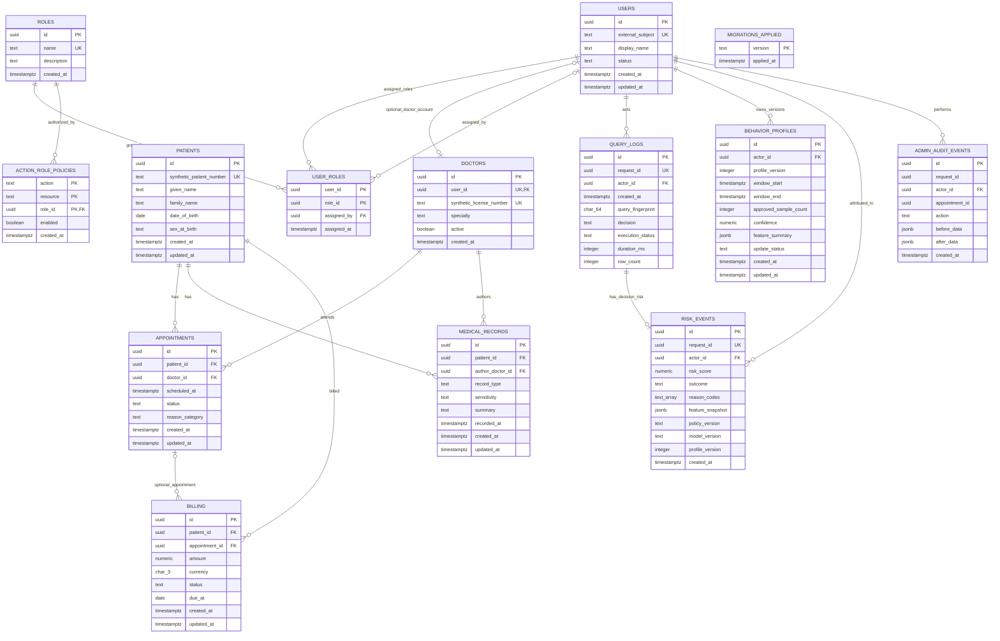

# QueryImmune database reference

This document describes the PostgreSQL schema represented by the repository's
migrations, including their final cumulative effect. It is a source-derived
reference; it does not assume that an object exists merely because it is
mentioned in a design document. The schema is a synthetic healthcare prototype.

Migrations are applied in filename order from `backend/migrations/`. The
migration runner also creates `qi_migrations.applied`. The repeatable synthetic
fixtures are in `backend/seed/001_synthetic_healthcare.sql`; demonstration SQL
is in `backend/sql/representative_queries.sql`.

## Schema inventory

There are 13 application base tables:

| Schema | Tables |
|---|---|
| `healthcare` | `users`, `roles`, `user_roles`, `patients`, `doctors`, `appointments`, `medical_records`, `billing` |
| `security` | `query_logs`, `behavior_profiles`, `risk_events`, `action_role_policies`, `admin_audit_events` |

The migration runner creates one additional bookkeeping table, `qi_migrations.applied`.
The `healthcare.general_doctor_directory` relation created in migration 012 is a
view, not a base table. It selects clinician identifiers, display names, and
specialties by joining `healthcare.doctors` and `healthcare.users`, with
`security_invoker = true`. Migration 014 adds four reporting views (two
security summaries and two appointment reports).

## Entity relationship diagram

The diagram shows declared foreign keys and their cardinalities. It does not
draw the `general_doctor_directory` view as a base entity. The migration ledger
is operational metadata and has no foreign-key relationship to application data.



`text_array` in the diagram denotes PostgreSQL `text[]`. In `USER_ROLES`, both
`user_id` and `role_id` are parts of the composite primary key. In
`ACTION_ROLE_POLICIES`, `action`, `resource`, and `role_id` form the composite
primary key.

## Relational schema

Notation: `PK` = primary key, `FK` = foreign key, `UQ` = unique key, and
`NN` = not null. Constraint details and delete behavior are in the data
dictionary below.

```text
healthcare.users(
  id PK, external_subject UQ, display_name, status, created_at, updated_at
)
healthcare.roles(
  id PK, name UQ, description, created_at
)
healthcare.user_roles(
  user_id PK/FK -> healthcare.users.id,
  role_id PK/FK -> healthcare.roles.id,
  assigned_by FK -> healthcare.users.id,
  assigned_at
)
healthcare.patients(
  id PK, synthetic_patient_number UQ, given_name, family_name,
  date_of_birth, sex_at_birth, created_at, updated_at
)
healthcare.doctors(
  id PK, user_id UQ/FK -> healthcare.users.id,
  synthetic_license_number UQ, specialty, active, created_at
)
healthcare.appointments(
  id PK, patient_id FK -> healthcare.patients.id,
  doctor_id FK -> healthcare.doctors.id,
  scheduled_at, status, reason_category, created_at, updated_at
)
healthcare.medical_records(
  id PK, patient_id FK -> healthcare.patients.id,
  author_doctor_id FK -> healthcare.doctors.id,
  record_type, sensitivity, summary, recorded_at, created_at, updated_at
)
healthcare.billing(
  id PK, patient_id FK -> healthcare.patients.id,
  appointment_id FK -> healthcare.appointments.id NULL,
  amount, currency, status, due_at, created_at, updated_at
)
security.query_logs(
  id PK, request_id UQ, actor_id FK -> healthcare.users.id,
  created_at, query_fingerprint, decision, execution_status, duration_ms, row_count
)
security.behavior_profiles(
  id PK, actor_id FK -> healthcare.users.id, profile_version,
  window_start, window_end, approved_sample_count, confidence,
  feature_summary, update_status, created_at, updated_at,
  UQ(actor_id, profile_version)
)
security.risk_events(
  id PK, request_id UQ/FK -> security.query_logs.request_id,
  actor_id FK -> healthcare.users.id, risk_score, outcome, reason_codes,
  feature_snapshot, policy_version, model_version, profile_version NULL, created_at
)
security.action_role_policies(
  action PK, resource PK, role_id PK/FK -> healthcare.roles.id,
  enabled, created_at
)
security.admin_audit_events(
  id PK, request_id, actor_id FK -> healthcare.users.id,
  appointment_id, action, before_data, after_data, created_at
)
qi_migrations.applied(version PK, applied_at)
```

### Relationship cardinalities

- **One-to-one, optional on both sides:** a user can have zero or one doctor row,
  and a doctor can have zero or one linked user. `doctors.user_id` is nullable
  and unique. The seed assigns the synthetic doctor rows to users.
- **One-to-many:** a user has role assignments; a role is assigned to users;
  patients and doctors can each have many appointments and medical records;
  patients can have many billing rows; users can have many query logs, risk
  events, and behavior-profile versions; roles can have many action policies.
- **One-to-many:** a user can perform many appointment-administration audit
  events. `appointment_id` is deliberately not an FK, preserving the original
  appointment identifier after a successful delete.
- **Many-to-many:** users and roles are related through `user_roles`. The
  association itself has the additional optional `assigned_by` user and
  `assigned_at` timestamp.
- **Optional one-to-many:** an appointment can have zero or many billing rows.
  A billing row may have no appointment (`appointment_id IS NULL`) or one
  referenced appointment.
- **One-to-zero-or-one:** each risk event refers to one query log; a query log
  may have no risk event or one risk event. The unique, non-null
  `risk_events.request_id` FK enforces this maximum cardinality.

## Data dictionary

`NN` means `NOT NULL`; defaults are shown after `DEFAULT`. `PK`, `FK`, and
`UQ` identify key participation. PostgreSQL primary-key and unique constraints
create their own indexes; those implicit indexes are distinguished from the
explicit indexes listed after the dictionary. Unless specified otherwise, FKs
use PostgreSQL's default `ON UPDATE NO ACTION` and `ON DELETE NO ACTION`.

### `healthcare.users`

Identity records used to resolve external token subjects to internal actors.

| Column | Type | Null/default | Key / validation / meaning |
|---|---|---|---|
| `id` | `uuid` | NN; `gen_random_uuid()` | PK |
| `external_subject` | `text` | NN | UQ; identity-provider subject |
| `display_name` | `text` | NN | Trimmed length 1–120 |
| `status` | `text` | NN; `'active'` | One of `active`, `suspended`, `disabled` |
| `created_at` | `timestamptz` | NN; `now()` | Creation time |
| `updated_at` | `timestamptz` | NN; `now()` | Update time; no trigger currently maintains it |

### `healthcare.roles`

Role catalog referenced by user assignments and database action policies.

| Column | Type | Null/default | Key / validation / meaning |
|---|---|---|---|
| `id` | `uuid` | NN; `gen_random_uuid()` | PK |
| `name` | `text` | NN | UQ; final check is lowercase identifier pattern `^[a-z][a-z0-9_]{0,62}$` |
| `description` | `text` | NN | Human-readable role description |
| `created_at` | `timestamptz` | NN; `now()` | Creation time |

Migration 001 initially limited role names to a fixed set. Migration 009
replaces that check with the final identifier-format check. Role permission is
not implied by a role name; it is represented by `security.action_role_policies`.

### `healthcare.user_roles`

Association table implementing the user–role many-to-many relationship.

| Column | Type | Null/default | Key / validation / meaning |
|---|---|---|---|
| `user_id` | `uuid` | NN | PK part; FK to `healthcare.users.id`, delete restricted |
| `role_id` | `uuid` | NN | PK part; FK to `healthcare.roles.id`, delete restricted |
| `assigned_by` | `uuid` | nullable | FK to `healthcare.users.id`, delete restricted |
| `assigned_at` | `timestamptz` | NN; `now()` | Assignment time |

### `healthcare.patients`

Synthetic patient identities and demographic fields. The runtime role receives
only `id` and `synthetic_patient_number`; the broader fields are not granted.

| Column | Type | Null/default | Key / validation / meaning |
|---|---|---|---|
| `id` | `uuid` | NN; `gen_random_uuid()` | PK |
| `synthetic_patient_number` | `text` | NN | UQ; must start with `SYN-` |
| `given_name` | `text` | NN | Synthetic given name |
| `family_name` | `text` | NN | Synthetic family name |
| `date_of_birth` | `date` | NN | Must be no later than `CURRENT_DATE` |
| `sex_at_birth` | `text` | NN | One of `female`, `male`, `intersex`, `unknown` |
| `created_at` | `timestamptz` | NN; `now()` | Creation time |
| `updated_at` | `timestamptz` | NN; `now()` | Update time; no trigger currently maintains it |

### `healthcare.doctors`

Doctor profile and optional link to an application user.

| Column | Type | Null/default | Key / validation / meaning |
|---|---|---|---|
| `id` | `uuid` | NN; `gen_random_uuid()` | PK |
| `user_id` | `uuid` | nullable | UQ; FK to `healthcare.users.id`, delete restricted |
| `synthetic_license_number` | `text` | NN | UQ; must start with `SYN-` |
| `specialty` | `text` | NN | Free-text specialty |
| `active` | `boolean` | NN; `true` | Active-profile flag |
| `created_at` | `timestamptz` | NN; `now()` | Creation time |

PostgreSQL unique constraints permit more than one NULL in `user_id`, while
preventing two non-NULL doctor rows from referencing the same user.

### `healthcare.appointments`

Appointment occurrence, status, and reason category.

| Column | Type | Null/default | Key / validation / meaning |
|---|---|---|---|
| `id` | `uuid` | NN; `gen_random_uuid()` | PK |
| `patient_id` | `uuid` | NN | FK to `healthcare.patients.id`, delete restricted |
| `doctor_id` | `uuid` | NN | FK to `healthcare.doctors.id`, delete restricted |
| `scheduled_at` | `timestamptz` | NN | Scheduled instant |
| `status` | `text` | NN | One of `scheduled`, `completed`, `cancelled`, `no_show` |
| `reason_category` | `text` | NN | Trimmed length 1–80 |
| `created_at` | `timestamptz` | NN; `now()` | Creation time |
| `updated_at` | `timestamptz` | NN; `now()` | Update time; no trigger currently maintains it |

### `healthcare.medical_records`

Synthetic medical-record metadata and restricted sample summary text. The
runtime role has no SELECT grant on this table.

| Column | Type | Null/default | Key / validation / meaning |
|---|---|---|---|
| `id` | `uuid` | NN; `gen_random_uuid()` | PK |
| `patient_id` | `uuid` | NN | FK to `healthcare.patients.id`, delete restricted |
| `author_doctor_id` | `uuid` | NN | FK to `healthcare.doctors.id`, delete restricted |
| `record_type` | `text` | NN | One of `visit_note`, `lab_summary`, `diagnosis`, `prescription` |
| `sensitivity` | `text` | NN | One of `standard`, `sensitive`, `restricted` |
| `summary` | `text` | NN | Trimmed length 1–4000 |
| `recorded_at` | `timestamptz` | NN; `now()` | Time recorded |
| `created_at` | `timestamptz` | NN; `now()` | Row creation time |
| `updated_at` | `timestamptz` | NN; `now()` | Update time; no trigger currently maintains it |

### `healthcare.billing`

Billing rows associated with a patient and optionally an appointment. The
runtime role cannot select individual rows; it uses the bounded aggregate
function described below.

| Column | Type | Null/default | Key / validation / meaning |
|---|---|---|---|
| `id` | `uuid` | NN; `gen_random_uuid()` | PK |
| `patient_id` | `uuid` | NN | FK to `healthcare.patients.id`, delete restricted |
| `appointment_id` | `uuid` | nullable | FK to `healthcare.appointments.id`, delete restricted |
| `amount` | `numeric(12,2)` | NN | Must be nonnegative |
| `currency` | `char(3)` | NN; `'USD'` | Must match uppercase three-letter pattern |
| `status` | `text` | NN | One of `pending`, `paid`, `waived`, `refunded` |
| `due_at` | `date` | nullable | Optional due date |
| `created_at` | `timestamptz` | NN; `now()` | Creation time; used by the summary filter |
| `updated_at` | `timestamptz` | NN; `now()` | Update time; no trigger currently maintains it |

### `security.query_logs`

One durable decision/execution lifecycle row per request. It stores a query
fingerprint and execution metadata, not the result rows.

| Column | Type | Null/default | Key / validation / meaning |
|---|---|---|---|
| `id` | `uuid` | NN; `gen_random_uuid()` | PK |
| `request_id` | `uuid` | NN; `gen_random_uuid()` | UQ; request correlation identifier |
| `actor_id` | `uuid` | NN | FK to `healthcare.users.id`, delete restricted |
| `created_at` | `timestamptz` | NN; `now()` | Decision creation time |
| `query_fingerprint` | `char(64)` | NN | Exactly 64 lowercase hexadecimal characters |
| `decision` | `text` | NN | One of `allow`, `review`, `block` |
| `execution_status` | `text` | NN | One of `not_run`, `succeeded`, `failed` |
| `duration_ms` | `integer` | nullable | If present, nonnegative |
| `row_count` | `integer` | nullable | If present, nonnegative |

Table check constraint: a `review` or `block` must have `not_run` execution
status; an `allow` may be `not_run`, `succeeded`, or `failed`. Migration 002's
`security.finish_query_log` function finalizes only an allowed row still marked
`not_run`, with nonnegative duration and optional nonnegative row count.

### `security.behavior_profiles`

Per-actor, versioned summary of approved workload behavior.

| Column | Type | Null/default | Key / validation / meaning |
|---|---|---|---|
| `id` | `uuid` | NN; `gen_random_uuid()` | PK |
| `actor_id` | `uuid` | NN | FK to `healthcare.users.id`, delete restricted |
| `profile_version` | `integer` | NN | Positive; unique with `actor_id` |
| `window_start` | `timestamptz` | NN | Profile sample-window start |
| `window_end` | `timestamptz` | NN | Must be greater than or equal to `window_start` |
| `approved_sample_count` | `integer` | NN; `0` | Nonnegative |
| `confidence` | `numeric(5,4)` | NN | Between 0 and 1 inclusive |
| `feature_summary` | `jsonb` | NN | Must be a JSON object |
| `update_status` | `text` | NN | One of `seeded`, `active`, `quarantined`, `superseded` |
| `created_at` | `timestamptz` | NN; `now()` | Version creation time |
| `updated_at` | `timestamptz` | NN; `now()` | Update time |

Unique constraint: `(actor_id, profile_version)`. Migration 004 creates
`security.append_behavior_profile`; migrations 006 and 007 further constrain
eligible observations, versioning, profile contents, confidence, and observed
result-size statistics. Migration 007 also removes unsupported seeded
result-size claims. These are function-level rules, not additional table
columns or constraints.

### `security.risk_events`

Risk/policy explanation associated with a query decision. `request_id` is unique
and references `query_logs`; the schema permits a log without a risk row but
prevents multiple risk rows for one log.

| Column | Type | Null/default | Key / validation / meaning |
|---|---|---|---|
| `id` | `uuid` | NN; `gen_random_uuid()` | PK |
| `request_id` | `uuid` | NN | UQ; FK to `security.query_logs.request_id`, delete restricted |
| `actor_id` | `uuid` | NN | FK to `healthcare.users.id`, delete restricted |
| `risk_score` | `numeric(5,2)` | NN | Between 0 and 100 inclusive |
| `outcome` | `text` | NN | One of `allow`, `review`, `block` |
| `reason_codes` | `text[]` | NN; empty array | Policy/risk reason codes |
| `feature_snapshot` | `jsonb` | NN; `{}` | Must be a JSON object |
| `policy_version` | `text` | NN | Length 1–80 |
| `model_version` | `text` | nullable | Provider/model label |
| `profile_version` | `integer` | nullable | If present, positive; no FK currently |
| `created_at` | `timestamptz` | NN; `now()` | Risk event creation time |

The `append_risk_event` function checks the request, actor, and decision against
an existing `query_logs` row before inserting. The table definition itself does
not enforce actor equality with that row, nor does it link `profile_version` to
the actor's profile.

### `security.action_role_policies`

Database-backed, default-closed authorization facts added by migration 009.
Migration 011 seeds rules for the general appointments actions.

| Column | Type | Null/default | Key / validation / meaning |
|---|---|---|---|
| `action` | `text` | NN | PK part; lowercase action identifier pattern |
| `resource` | `text` | NN | PK part; lowercase resource identifier pattern |
| `role_id` | `uuid` | NN | PK part; FK to `healthcare.roles.id`, delete restricted |
| `enabled` | `boolean` | NN; `true` | Whether this policy row is enabled |
| `created_at` | `timestamptz` | NN; `now()` | Row creation time |

### `security.admin_audit_events`

Append-only database trigger records for administrative appointment writes.
This is separate from `query_logs` and `risk_events`, which describe decisions
and executions in the protected SQL gateway.

| Column | Type | Null/default | Key / validation / meaning |
|---|---|---|---|
| `id` | `uuid` | NN; `gen_random_uuid()` | PK |
| `request_id` | `uuid` | NN | HTTP request correlation identifier |
| `actor_id` | `uuid` | NN | FK to `healthcare.users.id`, delete restricted |
| `appointment_id` | `uuid` | NN | Historical identifier; deliberately not an FK so delete events remain attributable |
| `action` | `text` | NN | One of `create`, `update`, `delete` |
| `before_data` | `jsonb` | nullable | Previous appointment row for update/delete; must be a JSON object |
| `after_data` | `jsonb` | nullable | New appointment row for create/update; must be a JSON object |
| `created_at` | `timestamptz` | NN; `now()` | Audit event time |

Checks require before/after payloads appropriate to the action. A database
trigger writes each event in the same transaction as the appointment change;
therefore a failed write or failed audit insert rolls the operation back.

### `qi_migrations.applied`

Migration-runner bookkeeping table created by `queryimmune_db.migrate`, not by
an application SQL migration.

| Column | Type | Null/default | Key / validation / meaning |
|---|---|---|---|
| `version` | `text` | NN | PK; applied migration filename |
| `applied_at` | `timestamptz` | NN; `now()` | Migration-record time |

## Constraints, foreign keys, and indexes

### Declared foreign keys

| Child column(s) | Referenced column | Delete behavior |
|---|---|---|
| `healthcare.user_roles.user_id` | `healthcare.users.id` | `RESTRICT` |
| `healthcare.user_roles.role_id` | `healthcare.roles.id` | `RESTRICT` |
| `healthcare.user_roles.assigned_by` | `healthcare.users.id` | `RESTRICT` |
| `healthcare.doctors.user_id` | `healthcare.users.id` | `RESTRICT`; nullable and unique |
| `healthcare.appointments.patient_id` | `healthcare.patients.id` | `RESTRICT` |
| `healthcare.appointments.doctor_id` | `healthcare.doctors.id` | `RESTRICT` |
| `healthcare.medical_records.patient_id` | `healthcare.patients.id` | `RESTRICT` |
| `healthcare.medical_records.author_doctor_id` | `healthcare.doctors.id` | `RESTRICT` |
| `healthcare.billing.patient_id` | `healthcare.patients.id` | `RESTRICT` |
| `healthcare.billing.appointment_id` | `healthcare.appointments.id` | `RESTRICT`; nullable |
| `security.query_logs.actor_id` | `healthcare.users.id` | `RESTRICT` |
| `security.behavior_profiles.actor_id` | `healthcare.users.id` | `RESTRICT` |
| `security.risk_events.request_id` | `security.query_logs.request_id` | `RESTRICT`; unique child FK |
| `security.risk_events.actor_id` | `healthcare.users.id` | `RESTRICT` |
| `security.action_role_policies.role_id` | `healthcare.roles.id` | `RESTRICT` |
| `security.admin_audit_events.actor_id` | `healthcare.users.id` | `RESTRICT` |

### Explicit indexes

Primary keys, unique constraints, and unique indexes have backing indexes
created by PostgreSQL. The following are explicitly declared by migrations:

| Index | Relation and indexed columns | Notes |
|---|---|---|
| `user_roles_role_user_idx` | `healthcare.user_roles(role_id, user_id)` | Reverse lookup from role; PK already starts with `user_id` |
| `patients_name_idx` | `healthcare.patients(family_name, given_name)` | Name lookup |
| `appointments_patient_time_idx` | `healthcare.appointments(patient_id, scheduled_at DESC)` | Patient timeline |
| `appointments_doctor_time_idx` | `healthcare.appointments(doctor_id, scheduled_at DESC)` | Doctor timeline |
| `appointments_status_time_idx` | `healthcare.appointments(status, scheduled_at)` | Status/time filtering |
| `appointments_scheduled_at_idx` | `healthcare.appointments(scheduled_at DESC)` | Added in migration 014; date-range lists not filtered by patient/doctor/status |
| `medical_records_patient_time_idx` | `healthcare.medical_records(patient_id, recorded_at DESC)` | Patient timeline |
| `medical_records_author_time_idx` | `healthcare.medical_records(author_doctor_id, recorded_at DESC)` | Author timeline |
| `medical_records_sensitivity_idx` | `healthcare.medical_records(sensitivity, recorded_at DESC)` | Sensitivity/time filtering |
| `billing_patient_time_idx` | `healthcare.billing(patient_id, created_at DESC)` | Patient billing timeline |
| `billing_status_due_idx` | `healthcare.billing(status, due_at)` | Partial; only rows where `status = 'pending'` |
| `billing_created_at_idx` | `healthcare.billing(created_at)` | Aggregate date filter; added in migration 008 |
| `query_logs_actor_time_idx` | `security.query_logs(actor_id, created_at DESC)` | Actor audit history |
| `query_logs_decision_time_idx` | `security.query_logs(decision, created_at DESC)` | Decision reporting |
| `behavior_profiles_actor_version_idx` | `security.behavior_profiles(actor_id, profile_version DESC)` | Latest profile lookup |
| `risk_events_outcome_time_idx` | `security.risk_events(outcome, created_at DESC)` | Outcome reporting |
| `risk_events_actor_time_idx` | `security.risk_events(actor_id, created_at DESC)` | Actor risk history |
| `action_role_policies_role_idx` | `security.action_role_policies(role_id, action, resource)` | Partial; only rows where `enabled` |
| `query_logs_created_at_idx` | `security.query_logs(created_at DESC)` | Added in migration 014; supports recent global reporting windows |
| `risk_events_created_at_idx` | `security.risk_events(created_at DESC)` | Added in migration 014; supports recent global reporting windows |
| `admin_audit_events_actor_time_idx` | `security.admin_audit_events(actor_id, created_at DESC)` | Actor audit history |
| `admin_audit_events_appointment_time_idx` | `security.admin_audit_events(appointment_id, created_at DESC)` | History, including deleted appointments |
| `admin_audit_events_request_idx` | `security.admin_audit_events(request_id)` | Request correlation |

Indexes let PostgreSQL find and order matching rows without scanning and sorting
the whole table. The migration-014 timestamp indexes support date-bounded administrative
reports on query/risk activity; their descending order also fits newest-first
requests. The new appointment schedule index supports date-range lists that
cannot use an index whose first key is patient, doctor, or status. Indexes
consume storage and add work to inserts/updates, so inspect
`EXPLAIN (ANALYZE, BUFFERS)` with representative data before adding more. For
example:

```sql
EXPLAIN (ANALYZE, BUFFERS)
SELECT id, scheduled_at, status
FROM healthcare.appointments
WHERE scheduled_at >= now() - interval '7 days'
ORDER BY scheduled_at DESC
LIMIT 100;
```

## Normalization assessment

The core healthcare model is relationally structured and broadly follows
normalization principles for its current scope:

- Users and roles are separated, with their many-to-many assignment resolved
  through `user_roles`.
- Patients, doctors, appointments, medical records, and billing each have
  separate row identities and use foreign keys rather than repeating related
  entity attributes.
- Action authorization is separated from the role catalog through
  `action_role_policies`; role permissions are data rather than duplicated role
  name checks in each request.
- Versioned behavior profiles separate per-actor historical versions rather
  than overwriting a single profile row.
- `admin_audit_events` stores immutable historical snapshots outside the
  normalized appointment row. Its JSONB payloads are intentional audit evidence,
  not duplicate current-state columns.

This is not a claim that every value is fully normalized to strict 1NF/3NF:

- `risk_events.reason_codes` is a PostgreSQL array, and `feature_summary` and
  `feature_snapshot` are JSONB objects. They support flexible, versioned
  security metadata but are not relationally atomic attributes if individual
  elements need strong constraints or frequent relational reporting.
- `risk_events.actor_id` and `outcome` repeat actor/decision information
  available from the referenced query log. This can be useful as an audit
  snapshot and for actor-scoped access, but equality is not enforced by a
  composite table constraint.
- `risk_events.profile_version` is a scalar reference-like value without a
  foreign key to a profile version.
- `billing.patient_id` and nullable `billing.appointment_id` are separately
  valid foreign keys, but do not enforce that the referenced appointment, when
  present, belongs to the same patient. Whether that is a required domain rule
  needs confirmation.
- `doctors.specialty`, status values, and record categories are text constrained
  by checks or left free-form, rather than normalized lookup tables. This is
  reasonable for a small fixed prototype; lookup tables are worth considering
  only if the values need independent metadata, lifecycle, or foreign-key
  reuse.
- A few foreign-key columns have no index whose leading key is that column:
  `user_roles.assigned_by` and `billing.appointment_id`. They may be appropriate
  additions if deletes/updates or joins on those relationships are expected at
  scale.

No unique temporal rule prevents overlapping appointments or duplicate
patient/doctor/time bookings. The repository does not establish that such a
rule is required; add one only after deciding the desired scheduling semantics.

## Referential-integrity findings and recommendations

These are recommendations only. No migration or schema changes are included in
this documentation update.

1. **Enforce risk-event actor consistency.** `risk_events.request_id` references
   a query log, while `risk_events.actor_id` separately references a user. The
   function `security.append_risk_event` checks actor equality on its write
   path, but the FK model does not guarantee that invariant for every
   database-level write path. Consider a composite unique key on
   `query_logs(request_id, actor_id)` and a composite FK from
   `risk_events(request_id, actor_id)`.
2. **Enforce behavior-profile version references.** When `profile_version` is
   non-NULL, consider a composite FK from `risk_events(actor_id, profile_version)`
   to `behavior_profiles(actor_id, profile_version)`. The profile table already
   has the corresponding unique key. This preserves optionality while rejecting
   nonexistent or cross-actor profile versions.
3. **Confirm billing patient/appointment consistency.** If every billing row
   with an appointment must refer to that appointment's patient, consider
   enforcing the pair with a composite FK. This requires a matching unique
   referenced key on appointments; the existing seed's NULL appointment row
   remains valid. Confirm the business rule before adding it.
4. **Review FK indexes against workload and deletion patterns.** Evaluate
   indexes on `user_roles.assigned_by` and `billing.appointment_id` with actual
   query plans and expected parent-row deletes/updates before adding indexes.
5. **Keep flexible security snapshots deliberate.** Retain arrays/JSONB where
   schema evolution and whole-snapshot audit semantics are more valuable than
   relational querying. If reason codes or snapshot properties become
   independently queried, validated, or joined, consider normalized child
   records or typed structures then; do not add duplicate tables preemptively.
6. **Consider update-time maintenance.** `updated_at` columns default on insert.
   The appointment-admin API maintains its update timestamp, and migration 013's
   appointment trigger only audits; it does not maintain timestamps for other
   tables. If direct SQL updates are introduced, establish one consistent
   application- or database-owned update policy so timestamps cannot become
   stale.
7. **Check indexes for redundancy with query plans.** In particular, assess
   whether the explicit descending behavior-profile index adds value alongside
   the unique `(actor_id, profile_version)` index. Do not remove it without
   measuring the production access pattern.

## Database objects and access model

The migrations define one trigger (`appointments_admin_audit`, migration 013)
and no `CREATE PROCEDURE` procedures. They define PostgreSQL functions:

- `security.append_query_log` and `security.append_risk_event` append audit
  records through `SECURITY DEFINER` functions.
- `security.finish_query_log` finalizes an allowed execution once.
- `security.append_behavior_profile` appends a guarded, versioned profile.
- `security.billing_summary(date, integer)` returns a bounded aggregate without
  granting the runtime role access to raw billing rows.
- `security.orm_admin_actor_allowed()` gates ORM RLS to an active admin actor.
- `security.audit_appointment_admin_change()` is the trigger function that
  atomically captures appointment create/update/delete snapshots.

`healthcare.general_doctor_directory` is an invoker-security view over doctor
and user display data. Migration 010 enables RLS for doctors, appointments,
patients, query logs, risk events, and behavior profiles. Migration 008 narrows
healthcare access to specific columns and migrations 010/012 grant only the
needed security relations and view. The current query gateway is read-only:
demonstrative `UPDATE`/transaction statements in
`backend/sql/representative_queries.sql` are not runtime CRUD endpoints.

| Migration | Database effect relevant to this reference |
|---|---|
| `001_database_foundation.sql` | Creates schemas, roles, 11 initial tables, constraints, indexes, and audit append functions |
| `002_execution_audit.sql` | Adds the audit finalization function |
| `003_narrow_runtime_reads.sql` | Narrows the initial broad healthcare table grant |
| `004_behavior_profiles.sql` | Adds the profile append function and its sample/provenance checks |
| `005_seed_profile_metadata.sql` | Normalizes the seeded profile JSON representation |
| `006_approved_drift_learning.sql` | Extends profile update eligibility to approved workload drift |
| `007_harden_profile_statistics.sql` | Tightens profile update bounds and repairs unsupported seeded result-size statistics |
| `008_minimize_runtime_data_access.sql` | Adds the billing date index, column-level grants, and bounded billing aggregate function |
| `009_database_action_authorization.sql` | Adds action/role policy table and relaxes role names to a format check |
| `010_actor_row_security_and_security_defaults.sql` | Establishes actor RLS and closes broad security-schema default grants |
| `011_general_appointments_policy.sql` | Seeds database authorization rows for general appointments actions |
| `012_general_doctor_directory.sql` | Adds the invoker-security doctor directory view |
| `013_admin_appointment_crud.sql` | Adds isolated ORM privileges, admin-only appointment DML/RLS, and transactional CRUD audit events |
| `014_advanced_dbms_reporting.sql` | Adds curated reporting views, a validated admin appointment status function, and reporting indexes |

`backend/sql/representative_queries.sql` contains examples of joins, aggregate
queries, filters, updates, transactions, rollback discussion, and audit joins.
It is illustrative SQL, not evidence of an exposed write path. The seed file
creates synthetic users, roles, action policies, doctor/patient/appointment/
medical-record/billing rows, and an initial behavior profile; it does not seed
query logs or risk events.

## Reporting views and database routine

Migration 014 creates views over real QueryImmune activity:

| View | Contents / purpose | Access boundary |
|---|---|---|
| `security.query_execution_daily_summary` | Daily counts by decision and execution status, total returned rows, and average/minimum/maximum execution time | `qi_orm_admin` only; requires an active admin transaction context |
| `security.risk_event_daily_summary` | Daily event counts and average/minimum/maximum risk score by outcome | `qi_orm_admin` only; requires an active admin transaction context |
| `healthcare.admin_appointment_report` | Per-doctor appointment counts, scheduled/completed counts, and first/last appointment times; doctors without appointments remain in the report | `qi_orm_admin` only; requires an active admin transaction context |
| `healthcare.admin_appointment_detail` | Appointment details joined to synthetic patient number and doctor name/specialty; deliberately excludes patient demographics | `qi_orm_admin` only; requires an active admin transaction context |
| `healthcare.general_doctor_directory` | Existing clinician directory with display name and specialty | Runtime can read the security-invoker view under underlying RLS |

The four migration-014 report views use PostgreSQL's `security_barrier` option
and their predicates call `security.orm_admin_actor_allowed()`. They are
owner-context (not `security_invoker`) views: the owner can read their source
relations without granting raw query/risk table access to the application
login. They expose only the listed aggregate/report columns, not raw SQL,
request identifiers, or risk snapshots. `qi_orm_admin` receives SELECT on these
views, not direct SELECT on the query or risk event tables. Reports are for the
administrative API credential and must be queried with the authenticated
admin/request context established by `session_scope()`. This boundary depends
on keeping the ORM credential private and the API authorization path intact.

`security.admin_update_appointment_status(uuid, text)` is a PL/pgSQL function
with invoker privileges. It validates the ID and one of the schema-supported
appointment statuses, requires active admin/request transaction context,
updates the appointment and `updated_at`, and raises PostgreSQL errors for bad
input (`22023`), unauthorized context (`42501`), and missing appointments
(`P0002`). It is executable only by `qi_orm_admin`. The existing appointment
audit trigger writes the change to `security.admin_audit_events` within the
same transaction; errors or rollback undo both the update and audit event.
This function is not granted to or used by the AI query gateway.

## Advanced DBMS SQL and transactions demonstration

Run [`backend/sql/advanced_dbms_demo.sql`](backend/sql/advanced_dbms_demo.sql)
with `psql` and the `DATABASE_ORM_ADMIN_URL` after applying migrations and
loading fixtures. The script sets a seeded synthetic admin actor and a request
ID in each transaction, reflecting the context that the authenticated API
establishes. It demonstrates:

- DML `INSERT`, `UPDATE` through the validated function, and `DELETE`; each
  committed appointment write creates an audit row.
- `WHERE`, `ORDER BY`, `GROUP BY`, `HAVING`, and `COUNT`, `SUM`, `AVG`, `MIN`,
  and `MAX`.
- Multi-table `INNER JOIN`, `LEFT JOIN`, and a meaningful `RIGHT JOIN` that
  retains doctors with zero appointments; the left/right appointment counts
  should agree.
- Scalar and correlated `EXISTS` subqueries.
- `BEGIN`/`COMMIT`, `ROLLBACK TO SAVEPOINT` after an intentionally invalid
  foreign key and a rejected status, a savepoint rollback of an otherwise valid
  update, and a full `ROLLBACK` proving the update and trigger audit are atomic.

Example shape of a daily execution report (counts and dates depend on the
database contents):

```text
 activity_day | decision | execution_status | request_count | returned_row_count | avg_duration_ms
--------------+----------+------------------+---------------+--------------------+----------------
 2026-10-14   | allow    | succeeded        |             8 |                 31 |           12.50
 2026-10-14   | block    | not_run          |             2 |                  0 |            NULL
```

Example transactional write output:

```text
Created appointment: <new UUID>
 status_inside_savepoint
------------------------
 completed
 committed_status
------------------
 completed
 action | event_count
--------+------------
 create |           1
 delete |           1
 update |           1
```

The deliberately invalid insert/status statements report constraint/input
errors. Rolling back to their savepoints lets the transaction proceed; the
error is not silently swallowed. The full rollback at the end restores the
seed appointment's original status and removes that transaction's audit event.

## SQLAlchemy administrative ORM and CRUD boundary

SQLAlchemy 2.x mappings live in `backend/src/queryimmune_db/orm/models.py`.
They describe the healthcare, security, audit, and migration-ledger tables,
including declared keys, foreign keys, relationships, constraints, and explicit
indexes. They are metadata only: `Base.metadata.create_all()` is not part of the
application, and migrations remain the sole schema-change mechanism.

The ORM session support is isolated in
`backend/src/queryimmune_db/orm/session.py`. It uses
`DATABASE_ORM_ADMIN_URL` and PostgreSQL through Psycopg 3. The API receives a
distinct `queryimmune_orm_admin` login, which inherits only the
`qi_orm_admin` capability group; it is not the bootstrap, owner, or
`qi_runtime`/runtime login. Migration 013 grants this group appointment DML and
audit reads only. Row-level security permits rows only when the transaction
actor is an active user with the database `admin` role.

The actor ID used by RLS is a transaction-local PostgreSQL setting, which a
holder of the ORM login can set directly. It is defense in depth for trusted
application code, not independent proof of a JWT or protection against theft
of the ORM credential. The API verifies the token and database action policy;
the ORM credential must remain private to the API deployment.

`session_scope()` sets transaction-local actor and request identifiers and uses
a SQLAlchemy transaction context: normal exit commits, raised exceptions roll
the transaction back and are re-raised, and the session is always closed.
Appointment routes under `/api/v1/admin/appointments` authorize the actor
against `security.action_role_policies`; request bodies cannot choose an actor
or submit SQL. The CRUD API exposes only appointment fields and uses ORM
expressions, validation, bounded pagination, safe filters, and 404/409/422
error handling.

Every successful appointment create/update/delete fires a database trigger
that appends to `security.admin_audit_events` in the same transaction. The
admin-only `GET /api/v1/admin/appointments/audit` endpoint exposes a paginated
audit view. This is separate from query execution audit tables to avoid
misrepresenting CRUD as an AI query decision. The synthetic demo seeds a
`demo:admin` identity; `queryimmune_db.api.dev_token --subject demo:admin`
issues its short-lived token only in explicitly enabled local demo mode.

The AI-generated SQL path is unchanged: it continues to use the Psycopg
read-only runtime connection, SQLGlot validation, actor scoping, fixed
templates/canonical query validation, and existing query/risk audit lifecycle.
ORM credentials are never used for generated SQL.

## Verification notes

The schema and seeded-data tests are in `backend/tests/test_database.py`.
Database-backed cases require a migrated, seeded PostgreSQL instance and
`DATABASE_URL`; source-level tests inspect migration definitions without a live
database. ORM metadata and transaction behavior are tested in
`backend/tests/test_orm.py`; API behavior and authorization are tested in
`backend/tests/test_admin_appointments.py`. PostgreSQL-backed CRUD/RLS/audit
integration still requires validation against PostgreSQL; SQLite transaction
tests are not a substitute for role, RLS, trigger, or migration verification.
