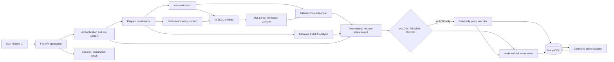

# QueryImmune Engineering Blueprint

**Project:** QueryImmune — Adaptive Workload-Aware AI Database Defense  
**Event:** DBTHON 26 – Database Systems Hackathon  
**Domain:** Healthcare database security  
**SDG alignment:** SDG 9 – Industry, Innovation and Infrastructure  
**Status:** Architecture and implementation plan; no implementation is specified here.

## 1. Product goal and scope

QueryImmune is a policy enforcement and workload intelligence layer between a user-facing natural-language interface and PostgreSQL. It translates a user request into a constrained database action, compares that action with the request, and evaluates it using deterministic policy plus learned workload context. The enforcement decision is made before database execution.

The central research hypothesis is: **learned behavioral context can serve as an additional authorization signal for AI-generated database actions, while deterministic controls remain authoritative.** This is a hypothesis to evaluate, not a novelty claim or a result. RBAC, anomaly detection, SQL validation, SQL firewalls, and NL2SQL are established techniques; the project contribution is their integrated, auditable use in this workflow.

Hackathon MVP boundaries:

- Use a synthetic healthcare dataset. Do not load real patient data.
- Support a deliberately limited read-oriented SQL subset for the demo. Mutation requests may be classified and denied or sent to review; automatic write execution is out of MVP scope.
- Use PostgreSQL as the system of record for domain data, behavior profiles, decisions, and audit events.
- Keep the LLM outside the database trust boundary. It receives only approved schema/context metadata and returns a candidate action; it never receives credentials or a database connection.
- Make AI-provider calls replaceable, time-bounded, and optional. A deterministic fixture/mock provider must make the demo reproducible without a remote model.
- Use human review as a recorded decision workflow, not as an automatic bypass. No high-risk action executes merely because an LLM or anomaly model recommends it.

## 2. System architecture



Logical deployment components:

1. **Web UI:** Submit requests, inspect decisions and safe result previews, review risk factors, and inspect the audit timeline.
2. **API/application:** Authentication context, request lifecycle, validation, orchestration, error mapping, API docs, and structured logging.
3. **Policy and analysis modules:** Intent/action comparison, SQL policy checks, risk scoring, behavioral deviation, and profile update eligibility.
4. **PostgreSQL:** Healthcare demo domain, identity/role mappings, baseline profiles, audit history, and evaluation run records.
5. **Model adapter:** A narrow interface to a configured NL2SQL/intent model. The provider is untrusted and replaceable.
6. **Evaluation runner:** Replays a versioned labeled corpus against baselines and QueryImmune, exporting raw per-case outcomes and aggregate metrics.

For hackathon feasibility, these are modules in one API service, not separate microservices. Keep module interfaces stable so extraction into services remains possible if scale later justifies it.

## 3. Component responsibilities

| Component | Responsibility | Must not do |
|---|---|---|
| API/auth adapter | Validate request shape; establish user, role, and session context; enforce request limits | Trust client-supplied role or user identity |
| Intent extractor | Produce a typed intent: action, entities, filters, fields, purpose, sensitivity expectation, ambiguity | Generate executable SQL or authorize access |
| Context retriever | Return allowlisted schema descriptions, field classifications, relationships, and policy hints | Return secrets, unrestricted data samples, or unrelated records to the model |
| NL2SQL adapter | Generate one candidate SQL statement plus structured rationale/target mapping | Connect to PostgreSQL, execute SQL, or decide access |
| SQL validator | Parse with a PostgreSQL-aware parser; enforce statement count, syntax subset, object/column allowlists, and parameterization | Rely on regex alone or accept model claims as proof |
| Intent/action comparator | Compare parsed SQL semantics with typed intent: operation, tables, projections, predicates, limits, and joins | Treat textual similarity as semantic equivalence |
| Behavior analyzer | Compare the current action and workload features with the user's approved historical baseline; report drift and confidence | Grant permissions or change hard policy outcomes |
| Risk engine | Apply hard veto rules, calculate explainable risk, produce ALLOW/REVIEW/BLOCK with reason codes | Allow behavior score to override hard vetoes |
| Query executor | Execute only an ALLOW decision, on a read-only least-privilege connection, with transaction and timeout limits | Execute candidate SQL directly from the model |
| Audit service | Persist request, normalized action, policy/model versions, features, decision, execution outcome, and review/update linkage | Store unnecessary patient result contents or secrets |
| Profile updater | Apply bounded updates only from eligible approved events; preserve version/history and poisoning safeguards | Learn from blocked, unreviewed, anomalous, or model-only activity |
| Evaluation runner | Replay fixed cases, compute metrics, preserve per-case labels and versions | Invent or silently discard unfavorable outcomes |

## 4. Data flow and request lifecycle

1. The client submits a natural-language request. The server derives the authenticated principal and role from its trusted auth context; the request body cannot assign them.
2. The API creates a request ID and records a minimal intake event. It validates size, rate, and required context.
3. Intent extraction emits a typed, confidence-bearing intent. Ambiguous or unsupported requests stop for clarification/review before SQL execution.
4. The behavior module computes pre-generation workload context and deviation features using historical approved events. It does not feed patient rows to the model.
5. Context retrieval supplies only the schema subset and permitted metadata relevant to the intent.
6. The NL2SQL adapter returns a single candidate statement and structured target/action claims. Treat all output as hostile input.
7. The parser normalizes the SQL and checks that it is a single supported statement, uses permitted relations/columns, has safe predicates and bounded result size, and contains no disallowed constructs.
8. Intent/action comparison checks whether the normalized SQL implements the typed request. Missing/extra entities, sensitive fields, expanded scope, or unsupported filters count as mismatch.
9. The risk engine evaluates hard policy first (identity, role, operation, sensitivity, scope, SQL validity, mismatch, limits), then adds workload deviation and calibrated uncertainty. A hard veto always yields BLOCK. Otherwise policy thresholds map to ALLOW, REVIEW, or BLOCK.
10. The decision and its reason codes are durably audited. For REVIEW/BLOCK, no query is sent to the executor.
11. For ALLOW, the executor opens a bounded read-only transaction, sets statement/lock timeouts, applies row scoping where applicable, executes parameterized SQL, limits returned rows, and commits/rolls back. Errors are audited without exposing SQL internals or patient data to the client.
12. The audit record is completed with execution status and result metadata (such as row count and duration, not full result rows). The client receives a safe explanation and permitted result projection.
13. Profile update eligibility is evaluated separately. Only qualifying events enter a controlled update path; update provenance and profile version are recorded.

## 5. Threat model

### Assets

- Patient, medical record, appointment, and billing data in PostgreSQL.
- Credentials, signing keys, model-provider secrets, and database connection strings.
- Identity/role assignments, policies, behavior profiles, risk decisions, and audit integrity.
- Service availability and reproducibility of evaluation results.

### Trust boundaries and adversaries

- Authenticated users may make accidental, overbroad, or malicious requests, including attempting to access another patient's records.
- A compromised/overprivileged account may generate a workload far outside its normal behavior.
- The LLM may hallucinate, be prompted into unsafe output, return malformed SQL, or misrepresent its SQL.
- Prompt injection may appear in user text or in retrieved metadata. Treat both as data, not instructions.
- A database, API, model provider, or dependency may be misconfigured or compromised.
- An insider or automated actor may try to poison behavioral baselines or tamper with audit data.

### Main abuse cases and controls

| Abuse case | Primary controls |
|---|---|
| Unauthorized table/column or patient access | Server-derived identity/role; deterministic allowlists; row-scope enforcement; least-privilege DB role; hard veto |
| SQL injection or multi-statement execution | Parameterized values; parser/AST policy; single statement only; read-only transaction; no string interpolation of user values |
| LLM hallucinated or scope-expanded SQL | Parser, schema allowlist, intent/action comparison, scope/limit checks, fail closed on ambiguity |
| Prompt injection/model manipulation | Separate system policy from untrusted text; context minimization; never accept model authorization; deterministic post-generation checks |
| Destructive or high-risk operation | MVP read-only executor; explicit operation policy; REVIEW/BLOCK; no automatic high-risk execution |
| Baseline poisoning / gradual drift abuse | Only approved, eligible events; quarantine and bounded update rates; minimum sample counts; robust statistics; rollback/versioning; drift alerts |
| Audit tampering or repudiation | Append-oriented audit permissions; immutable event IDs and hashes as defense-in-depth; restricted DB role; export/backup in later phase |
| Data leakage through prompts, logs, or errors | Synthetic data; minimize prompt payload; redact secrets/PII; do not log result rows; generic client errors; retention controls |
| Denial of service / costly query | Request and concurrency limits; query timeout, row/result cap, cost/plan guard where feasible; model timeout and circuit breaker |
| Credential compromise | Environment-based secrets; separate runtime/migration roles; rotation guidance; no credentials in prompts or source control |

### Security invariants

1. The LLM never has DB credentials or direct database access.
2. Candidate SQL is never executed before parse, policy, intent match, risk decision, and durable decision audit.
3. Hard restrictions are deterministic and cannot be weakened by behavior history or model output.
4. REVIEW and BLOCK never execute the candidate query.
5. The runtime DB account has only the minimum required permissions; migration/seed privileges are separate.
6. Baseline updates are explicit, bounded, versioned, and attributable.
7. The demo uses synthetic data and does not claim production healthcare compliance certification.

## 6. Database architecture

Use PostgreSQL with migrations as the authoritative schema history. Prefer UUID primary keys, `timestamptz` timestamps in UTC, check constraints for enumerated states, foreign keys with deliberate deletion behavior, and indexes justified by access patterns. Store the domain and security audit data in separate schemas (for example `healthcare` and `security`) to clarify grants and ownership.

### Core entities

| Entity | Important fields and relationships |
|---|---|
| `User` | id, external_subject, display_name, status, created_at; unique external identity |
| `Role` | id, name, description; unique role name |
| `UserRole` | user_id, role_id, assigned_by, assigned_at; composite uniqueness and FK constraints |
| `Patient` | id, synthetic patient number, demographics with minimized fields, created_at |
| `Doctor` | id, user_id (optional FK), license/display metadata appropriate for synthetic demo |
| `Appointment` | id, patient_id, doctor_id, scheduled_at, status, reason category; FK and valid status/time constraints |
| `MedicalRecord` | id, patient_id, author_doctor_id, created_at, record_type, sensitivity, body or synthetic summary; access is tightly scoped |
| `Billing` | id, patient_id, appointment_id (optional), amount, currency, status, created_at; nonnegative amount constraint |
| `QueryLog` | id/request_id, actor_id, created_at, normalized fingerprint, decision, execution status, duration_ms, row_count; avoid storing raw result data |
| `BehaviorProfile` | id, actor_id, profile_version, window_start/end, approved sample count, feature summary, update status, updated_at; versioned and attributable |
| `RiskEvent` | id, request_id, actor_id, risk_score, outcome, reason codes, feature snapshot, policy/model/profile versions, created_at |

Supporting entities recommended for traceability:

- `AuditEvent`: append-oriented lifecycle event with request ID, event type, actor/service identity, timestamp, redacted metadata, and prior/event hash fields if implemented.
- `ReviewDecision`: reviewer, outcome, reason, timestamps, and referenced RiskEvent; reviewer identity must be distinct from the original request where practical.
- `PolicyVersion`: policy identifier, immutable version, effective period, and configuration fingerprint.
- `EvaluationRun` and `EvaluationCaseResult`: dataset/version, system variant, configuration, case label, prediction, latency, and metric inputs.
- `ProfileUpdate`: source event IDs, old/new profile versions, update reason, approval gate, and outcome.

### Constraints and indexes

- Foreign keys for every relationship; use `RESTRICT` for records where cascading deletion could erase audit/security history. Any synthetic-data reset should be an explicit seed/reset operation.
- Check constraints for statuses, bounded risk scores, positive profile versions, nonnegative durations/amounts, and valid time windows.
- Unique constraints for identities, role names, synthetic identifiers, and profile `(actor_id, profile_version)`.
- Index foreign keys and common access paths: patient/appointment dates, doctor/date, `QueryLog(actor_id, created_at)`, `RiskEvent(outcome, created_at)`, and profile actor/version. Consider partial indexes for unresolved reviews.
- Avoid indexing sensitive text or storing unbounded raw prompts by default.
- Consider row-level security as defense-in-depth for patient scoping, but do not rely on RLS alone: the app's DB principal and policy context must be designed so users cannot change their own scope.

### Transactions and roles

- Runtime service role: read-only access to allowlisted healthcare views/tables and insert-only access to security events through narrowly scoped functions or tables; no DDL, role management, or unrestricted writes.
- Migration role: schema ownership and DDL, used only by migration jobs.
- Seed role/job: synthetic fixture loading, not used by the running API.
- Executor transaction: `READ ONLY`, bounded statement timeout, fixed search path, and rollback on any error. The audit write may use a separate trusted transaction/connection so failed query transactions do not erase the decision record.
- Migration workflow must be repeatable, ordered, and safe to apply to an empty database. Seed data must be deterministic and clearly synthetic.

## 7. API architecture

Recommended implementation shape: modular monolith using Python, FastAPI, Pydantic, and a PostgreSQL driver/ORM with explicit transaction boundaries. Use PostgreSQL-aware SQL parsing (for example, SQLGlot configured for PostgreSQL) behind a validator interface. Pin dependencies and versions during implementation. The exact library choices can be revisited during the first development phase.

Initial API surface (versioned under `/api/v1`):

| Endpoint | Purpose |
|---|---|
| `POST /requests` | Submit a natural-language request; return request ID, intent summary, decision, reason codes, and safe result only when allowed |
| `GET /requests/{request_id}` | Read the decision/execution lifecycle subject to ownership or reviewer scope |
| `GET /audit/events` | Paginated authorized audit view with filters; never expose secrets or unrestricted patient data |
| `GET /reviews` | List pending review items for eligible reviewers |
| `POST /reviews/{risk_event_id}/decision` | Record reviewer allow/deny with identity, reason, and idempotency protection |
| `GET /health/live` | Process liveness only |
| `GET /health/ready` | Readiness for required dependencies without leaking infrastructure detail |
| `GET /openapi.json` | Generated API contract for local/demo use; protect or disable in production deployment |

Request/response interfaces should be typed. A request carries natural-language text and optional user-selected context, never trusted role or raw SQL. A response includes request ID, decision, stable reason codes, concise explanation, normalized action summary, and (for ALLOW only) a bounded/redacted result. Use consistent error envelopes, correlation IDs, request-size limits, pagination, idempotency for review decisions, and structured logs with redaction.

Authentication for the hackathon can be a seeded demo identity/session adapter, but it must be server-controlled and explicitly labeled demo-only. Keep the auth interface ready for OIDC/JWT validation. Never treat a UI dropdown as an authorization boundary.

## 8. AI architecture

### Typed stages

1. **Intent extraction:** Return a schema-validated object: `action`, `entities`, `fields`, `filters`, `requested_scope`, `purpose`, `ambiguities`, and confidence. Do not place raw model text directly into policy logic.
2. **Context retrieval:** Select only relevant schema names, safe descriptions, relationship metadata, sensitivity labels, and allowed query patterns. Avoid row retrieval unless there is a reviewed, minimized synthetic example requirement.
3. **SQL generation:** Ask for one candidate statement and structured mapping from requested entities/filters to SQL components. Structured output is a convenience, not a security control.
4. **Independent validation:** Parse SQL and derive actual operations, relations, columns, predicates, joins, and limits from its AST. Compare those facts to intent and policy metadata.
5. **Risk decision:** Deterministic security policy decides. Model confidence may contribute only as uncertainty/risk input; it cannot authorize.

### Model controls

- Use a provider interface with explicit timeout, retry budget, response-size limit, model/version tracking, and a local deterministic test/demo provider.
- Do not send credentials, direct identifiers, query results, or full records to an external provider. Synthetic schema metadata should be enough for the MVP.
- Treat user input and retrieved descriptions as untrusted prompt content. Delimit them and instruct the model to treat them as data; the downstream validator remains authoritative.
- Fail closed on provider errors, malformed output, unsupported SQL, low-confidence/ambiguous intent, or semantic mismatch: return REVIEW or BLOCK without execution.
- Persist provider/model/prompt-template version identifiers and normalized input/output metadata sufficient for reproducibility, while applying prompt and PII retention limits.

## 9. Security and risk decision architecture

The decision engine has two stages:

1. **Hard policy gate:** Identity active; role permits action; target entities/fields allowed; patient scope valid; operation in supported subset; SQL parses; one statement; no prohibited functions/relations; intent matches; row and time limits pass. A failed hard condition returns BLOCK (or REVIEW only for explicitly designated ambiguity cases) and cannot be offset by a low anomaly score.
2. **Risk assessment:** Combine explainable factors such as sensitivity, operation class, scope breadth, role/action fit, intent mismatch severity, query cost/size, behavior deviation, profile confidence, and model uncertainty. Apply documented thresholds to map to ALLOW/REVIEW/BLOCK. Thresholds must be configuration/versioned and calibrated on the evaluation corpus; do not imply universal clinical risk calibration.

Return a stable reason code list and per-factor evidence suitable for a demo, e.g. `ROLE_NOT_ALLOWED`, `SENSITIVE_FIELD`, `SCOPE_TOO_BROAD`, `INTENT_SQL_MISMATCH`, `WORKLOAD_DEVIATION`, `PROFILE_LOW_CONFIDENCE`, `QUERY_LIMIT_EXCEEDED`. Avoid opaque single-score decisions. Risk explanations must not reveal hidden policy details to an unauthorized requester.

### Controlled adaptive learning

- Separate **event observation** from **profile mutation**. Every event can be measured; only eligible events may update a profile.
- Initial baseline comes from deterministic synthetic seed behavior or a warm-up period clearly marked low confidence.
- Eligible samples: successfully executed, policy-allowed, non-reviewed-as-suspicious actions; optionally require reviewer confirmation for high-impact feature changes.
- Exclude BLOCK, unresolved REVIEW, failed SQL, anomalous outliers, and events during known incident/recovery windows.
- Use robust, bounded feature statistics (counts/frequencies and robust location/scale rather than unconstrained raw examples); clamp per-update change and update rate.
- Require minimum samples, use a rolling window/decay policy that is visible in profile metadata, detect abrupt shifts, and quarantine suspicious updates.
- Keep immutable profile versions and source event references; support rollback and offline recomputation. Behavior may increase scrutiny or trigger review, but cannot grant a role or relax hard policy.

## 10. Evaluation architecture

Build a versioned synthetic benchmark with fixed cases and labels before reporting metrics. Keep a case manifest, expected intent, expected safe/unsafe SQL properties, expected decision, sensitivity, actor/role, baseline context, drift state, and rationale. Split cases into development and held-out evaluation sets; avoid tuning and scoring on the same held-out cases.

Compare identical requests and context across:

1. **Plain NL2SQL:** generation followed by execution in a safe non-production harness; record unsafe/mismatched output without allowing access to sensitive real data.
2. **NL2SQL + static security rules:** SQL and role/scope/operation rules, no learned behavior signal.
3. **NL2SQL + anomaly detection:** static controls plus behavior deviation, with its contribution isolated.
4. **QueryImmune:** full intent comparison, deterministic risk policy, workload analysis, and controlled profile update.

Required metrics and definitions:

- **Dangerous query detection rate / recall:** labeled dangerous candidate actions rejected or held before execution divided by all labeled dangerous candidate actions.
- **False-positive rate:** labeled safe candidate actions blocked (report REVIEW separately) divided by all labeled safe actions.
- **Intent-to-SQL mismatch detection:** labeled mismatch candidates flagged before execution divided by all labeled mismatches; include mismatch types.
- **Workload drift detection:** drift episodes detected within the declared window divided by labeled drift episodes; report detection delay and false alerts.
- **Dangerous operations prevented before execution:** count and proportion of dangerous cases for which the executor was never invoked; instrument executor invocation to verify this.
- **Added latency:** end-to-end decision latency and stage breakdown, reporting p50/p95, sample size, environment, and whether model/network latency is included.

Also report decision coverage (ALLOW/REVIEW/BLOCK), per-role and per-risk-class breakdown, confidence intervals where sample size permits, and raw per-case outcomes. Never fabricate results. Label synthetic benchmark results as prototype results, include limitations, and keep model/provider/configuration versions with each run.

## 11. Repository structure

```text
QueryImmune/
├── README.md
├── docs/
│   ├── engineering-blueprint.md
│   ├── threat-model.md                 # optional extraction from this blueprint
│   ├── api.md                          # generated/curated API usage
│   └── evaluation.md                   # corpus and metric protocol
├── backend/
│   ├── pyproject.toml
│   ├── Dockerfile
│   ├── src/queryimmune/
│   │   ├── api/                        # routes, schemas, error mapping
│   │   ├── application/                # orchestration/use cases
│   │   ├── domain/                     # typed intents, decisions, policy types
│   │   ├── security/                   # SQL validation, risk, authz
│   │   ├── behavior/                   # features, drift, profile updates
│   │   ├── ai/                         # provider interface and adapters
│   │   ├── database/                   # repositories, transactions
│   │   └── observability/              # logging, metrics, redaction
│   └── migrations/
├── frontend/
│   ├── package.json
│   └── src/                            # request, decision, review, audit views
├── db/
│   ├── seed/                           # deterministic synthetic fixtures
│   └── policies/                       # versioned policy examples/config
├── evaluation/
│   ├── datasets/                       # synthetic versioned case manifests
│   ├── baselines/
│   ├── runner/
│   └── results/                        # generated, not hand-edited metrics
├── infra/
│   └── docker-compose.yml              # local API, UI, PostgreSQL
├── scripts/                            # setup, seed, evaluation entry points
├── .env.example                        # names and safe placeholders only
└── .gitignore
```

## 12. Development phases

1. **Contract and safety foundation:** Confirm supported SQL subset, role/action matrix, synthetic data policy, decision semantics, and threat cases. Create typed domain contracts and architecture records.
2. **Database foundation:** Define normalized schema, constraints, indexes, separate DB roles, migrations, synthetic deterministic seed, and transaction strategy.
3. **Deterministic request pipeline:** Build API/auth context, intent fixtures, schema context, SQL parser/validator, intent/action comparison, hard policy, decision/audit persistence, and read-only executor. Use a mock AI provider first.
4. **Behavior and adaptive update:** Define features and baseline lifecycle; implement drift scoring, confidence, review gates, versioning, rollback, and poisoning tests/fixtures.
5. **AI integration:** Add provider adapter, structured intent and SQL generation, timeouts, redaction, failure handling, version tracking, and prompt injection cases. Keep the mock provider available.
6. **Demo UI and operations:** Add request/decision/audit/review views, Docker Compose, environment configuration, API docs, health checks, structured logs, and reproducible startup instructions.
7. **Evaluation and hardening:** Freeze benchmark labels, implement baselines and metric runner, measure latency and executor invocation, review threat cases, document limitations, and prepare scripted demo scenarios.

Each phase should end with a runnable vertical slice and documented decisions. Avoid adding distributed infrastructure, complex model training, production identity integration, or write execution unless they directly support judging criteria and fit the time budget.

## 13. Acceptance criteria for complete project

### Architecture and database

- [ ] PostgreSQL is central to domain storage, security decisions/audit, and behavior history.
- [ ] All required entities exist with documented PKs, FKs, checks, unique constraints, and justified indexes.
- [ ] Migrations build an empty DB repeatably; synthetic seed data is deterministic and clearly labeled.
- [ ] Runtime, migration, and seed privileges are separated; runtime does not have DDL or unrestricted write access.
- [ ] Query execution uses bounded transactions, read-only enforcement for MVP, timeouts, safe search path, and row/result caps.

### Request safety

- [ ] The end-to-end flow records typed intent, candidate SQL, parsed action, semantic comparison, risk decision, and reason codes.
- [ ] Malformed, multi-statement, unsupported, overbroad, sensitive, mismatched, unauthorized, and high-cost candidates are not executed.
- [ ] Hard policy can veto all model/behavior signals; REVIEW and BLOCK demonstrably never invoke the executor.
- [ ] The model has no database credentials, and provider failure/invalid output fails closed.
- [ ] SQL injection, prompt injection, cross-patient access, and role spoofing have explicit automated cases.

### Behavior and audit

- [ ] Behavior profiles are per actor (and where justified role/context), versioned, confidence-scored, and inspectable.
- [ ] Only explicitly eligible events can update profiles; blocked, pending-review, and suspicious events cannot poison them.
- [ ] Profile updates have provenance, bounded change, rollback, and a drift/quarantine path.
- [ ] Every request has a durable audit trail including decision, policy/model/profile versions, execution outcome, and reason codes, with sensitive values minimized.

### API, operations, and usability

- [ ] API is typed, versioned, documented, and uses consistent errors, correlation IDs, pagination, and redaction.
- [ ] Local development starts reproducibly with Docker Compose and `.env.example`; no secrets are committed or hardcoded.
- [ ] Demo UI makes ALLOW/REVIEW/BLOCK and the main evidence understandable and exposes a review/audit workflow.
- [ ] Logs and health checks support diagnosis without leaking SQL secrets or patient data.

### Evaluation and delivery

- [ ] Four requested baselines run on the same fixed, versioned synthetic cases.
- [ ] All required metrics are computed from per-case outputs, and dangerous pre-execution prevention is measured at the executor boundary.
- [ ] Latency reports include environment, sample count, p50/p95, and stage/provider inclusion details.
- [ ] Results are reproducible from documented commands; no result is presented without recorded data/configuration.
- [ ] README includes setup, architecture, threat assumptions, demo walkthrough, evaluation method, limitations, and synthetic-data notice.
- [ ] Automated tests cover parser/policy boundaries, API lifecycle, DB constraints/transactions, baseline poisoning safeguards, and evaluation metric calculations.

## 14. Key decisions to freeze before implementation

The first development phase should explicitly settle: (1) supported SQL subset and whether all MVP execution is read-only; (2) exact role-to-entity/field/patient scope matrix; (3) intent schema and mismatch severity rules; (4) behavior features and profile update eligibility; (5) AI provider/demo fallback; (6) retention and redaction policy for prompts and audit metadata; and (7) benchmark labels and held-out split. These decisions materially affect security and evaluation and should be documented before implementation begins.
